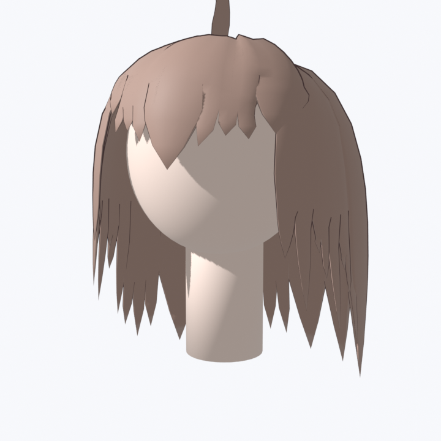
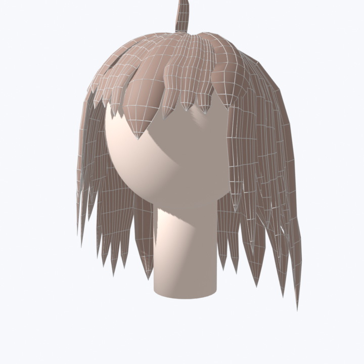
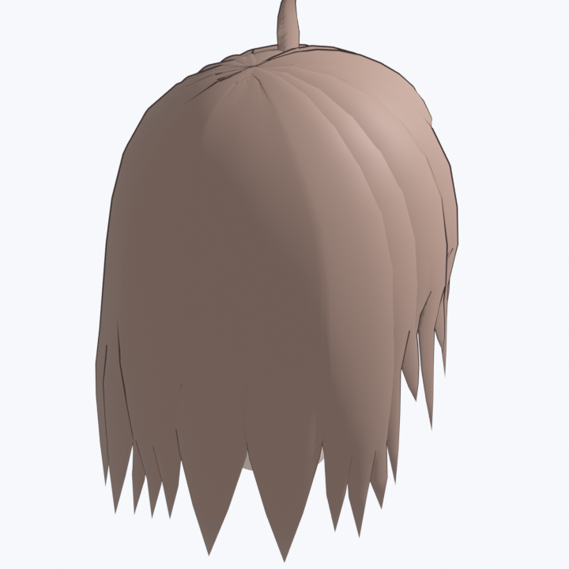
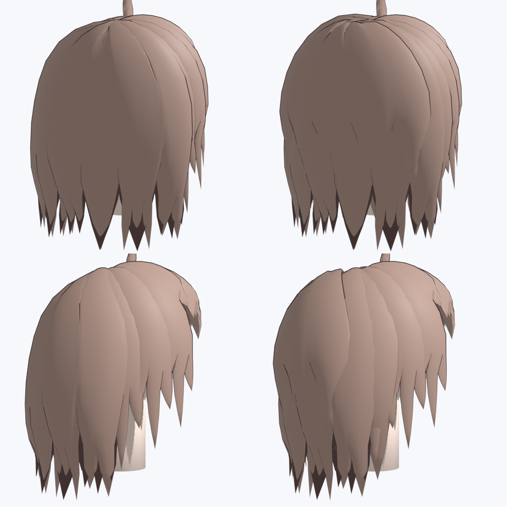
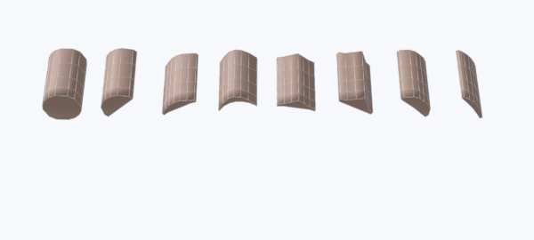
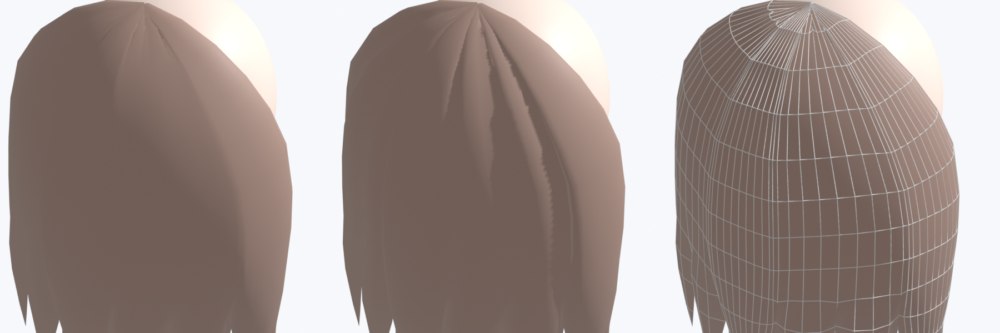
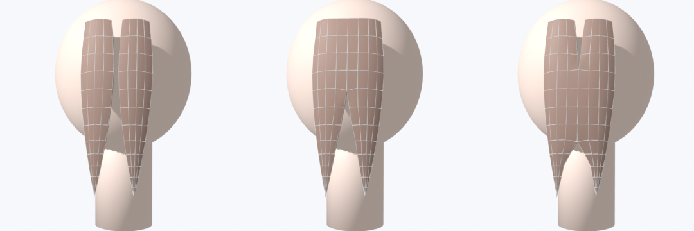

# Toon Hair Studio — VRM / VRChat向け アニメ髪メッシュメーカー (Blender 4.2+)

**頭の上をドラッグするだけ**で、トポロジーがきれいなアニメ風の髪メッシュを作れる Blender アドオンです。
普通にベジェカーブを編集して作ることもできます。どちらで作っても、同じカーブなので後から手で直せます。
シェーダーは作りません。MToon / lilToon / Poiyomi など、普段使っているシェーダーをそのまま当ててください。

- **頭に直接描く**:パーツのボタンを押して、頭の上をドラッグするだけ(Ctrl+クリックで消す、Ctrl+Z で取り消し)
- **頭のセットアップは1クリック**:首や体が付いた頭メッシュでも、頭の部分だけを測って中心を合わせる
- **パーツのプリセット**:前髪 / 横髪 / 後ろ髪 / 後ろ髪(立体) / もみあげ / アホ毛 / おさげ / 縦ロール
- **断面プリセット**:筒 / 半円 / レンズ / 三日月 / 山形 / 三角 / 台形 / 板。表と裏の間には**ベベル**(側面の細い帯)が入り、縁がきれいに出る
- **立体的な重ね**:同じカーブから手前と奥の層を自動で作り、ずらして重ねる。ふくらみ、内巻き / 外ハネ、房を立てる向きも調整できる
- 面はすべて四角形(三角形は尖った毛先だけ)。**曲がっている所と毛先にループを多めに配る**ので、ローポリでも形が崩れない
- ローポリ〜ミドルポリ(Low / Mid / High プリセット)。パネルに三角形数を表示
- 裏面は **厚みあり / 裏面ポリ / なし(片面)** から選択
- **分岐毛**:1本のガイドが途中で2〜6本の毛先に分かれる
- **横連結**:隣の房と1枚の面でつながる(前髪の塊、後ろ髪の一体感)。段差なしの「なめらか」と、房ごとに溝を残す「毛束感」から選べる
- 分岐と横連結は**組み合わせ可能**:「分岐する房が横につながった前髪」も1グループで作れる
- **法線はあり/なしを選択**:頭の球体方向に寄せたカスタム法線 / 普通のスムーズ / プロキシから転写
- **カール / うねり**:縦ロールのらせんと、左右のうねり
- **アウトライン**(任意):反転ハルのメッシュを生成。片面でも縁に線が出て、毛先は細くなる

| 正面 | トポロジー | 背面 |
|---|---|---|
|  |  |  |

*「サンプル髪型を生成」で作ったもの(Mid・厚みあり・アウトラインON)。前髪は5本のガイドが2〜3本に分岐して横連結、横髪は3本に分岐、後ろ髪はつむじから傘状に広がって横連結し、毛先で分岐しています。*

---

## インストール

1. `dist/toon_hair_studio-1.0.0.zip` をダウンロード
2. Blender 4.2 以降:`編集 > プリファレンス > アドオン > ▼ > ディスクからインストール` で zip を選択
3. 3Dビューのサイドバー(`N`キー)に **ToonHair** タブが出ます

Blender 5.2 でインストールと動作を確認済みです。

## 使い方

サイドバー(N)の **ToonHair** タブは、上から順に操作する作りになっています。

**① 準備**
- 頭のメッシュを選んで **「頭をセットアップ」** を押します。
- 頭の中心 `TH_HeadCenter`(楕円体の Empty)が自動で置かれます。ずれていたら、移動・スケールで直してください。これが房の外向きと法線の基準になります。

**② 作る(2通り)**
- **描く**:「前髪」「横髪」などのパーツボタンを押すと、そのまま描画モードに入ります。
  - 頭の上を**ドラッグ**すると1房できる
  - **Ctrl+クリック**で近くの房を消す
  - **Ctrl+Z** で直前の房を取り消す
  - 中ボタンとホイールで視点を動かせる
  - **Esc / 右クリック / Enter** で終了
  - 「選択中のグループに描き足す」で、あとから同じグループに追加できます
- **カーブで作る**:「グループ追加」でパーツを選ぶと、お手本の房が1本入ったグループができて、カーブの編集モードに入ります。
  - **1スプライン = 1房**。複製や押し出しで増やせます
  - **Alt+S** でその位置だけ幅が変わり、**Ctrl+T** でねじれます
  - 「カーソルに1房」で、3Dカーソル位置を根元にした房を追加できます
  - 既存のカーブも「選択カーブを毛束に」で使えます
- どちらで作っても、メッシュはリアルタイムで更新されます。描いた房を、カーブの編集モードで微調整することもできます。

**③ 調整**
- よく使う設定(LOD・断面・幅・厚み・分岐・重ね・横連結・ミラー・裏面)は、上のボックスにまとめています。
- 細かい設定は、下の閉じたパネルにあります(形状 / 立体 / 分岐毛 / 横連結 / 法線 / アウトライン)。

**④ 書き出し**
- **「書き出し用メッシュに統合」** で、全グループを1つの独立したメッシュにまとめます(VRM / FBX 用)。
- 全体の三角形数も表示されます。

すぐ試したい場合は **「サンプル髪型を生成」** を押してください。

## 立体的な髪(前後に重なる房)


*「後ろ髪(立体)」プリセット。左:重ねなし / 右:前後に重ねる(上:背面、下:横)*

「立体 (重ね / ふくらみ)」パネルで、同じカーブから層を自動で作ります。

- **重ね**:なし / 前に重ねる / 後ろに重ねる / 前後に重ねる
  - 手前の層は短めで毛先が外へ、奥の層は毛先が内へ向きます
  - 各層は層の中だけで横連結し、左右に半房ずれて、下の層のつなぎ目を隠します
  - **層の間隔・左右ずらし・長さ・幅・毛先の開き**を調整できます
- **ふくらみ / ふくらみ位置**:房の途中を外へ膨らませる(根元と毛先は頭に戻る)
- **毛先 外ハネ / 内巻き**
- **浮かせる**:グループごと頭から浮かせる。別グループで層を重ねるときに使います
- **向き(立てる)**:房を中心線のまわりに回して立てる。ひさし状の前髪や跳ね毛に

## 断面プリセット


*左から:筒 / 半円 / レンズ / 三日月 / 山形 / 三角 / 台形 / 板(毛先を平らにして断面を表示)*

「断面」を選ぶと、形・厚み・反り・ベベルがまとめて設定されます。半円・三角・台形は、裏が平らな非対称の断面です。

**ベベル**は、厚みありの断面で表と裏の間に入る、側面の細い帯です。縁が1点のナイフエッジにならないので、シルエット、アウトライン、影がきれいに出ます。0 にすると、従来のナイフエッジに戻ります。

## 複雑な形の作り方(前髪・分岐する横髪など)

| 作りたい形 | 設定 |
|---|---|
| 独立した毛束(アホ毛・触覚など) | 分岐数 1、横連結 OFF |
| 途中で2〜3本に分かれる横髪 | **分岐数 3**、分岐位置 0.6〜0.7、広がり 0.3、長さパターン「中央が長い」 |
| 毛先がギザギザで、つながった前髪 | ガイド数本 + **横連結 ON**(切れ込み位置 0.6〜0.7)+ **分岐数 2**(ばらつき 1、ランダム) |
| 一体感のある後ろ髪 | つむじから細い根元(根元の幅 0.1 前後)で放射状にガイドを引き、横連結 ON |

### 分岐毛
1本のガイドから、途中で複数の毛先に分かれます。分岐点までは1本の房として共有するので、継ぎ目はありません。

- **分岐数 / ばらつき**:房ごとにランダムで ±n 本変えると自然になる
- **分岐位置**:根元0 〜 毛先1
- **広がり**:分岐後に外へ開く量。短い枝ほど開きは控えめになる
- **長さの差 / 長さパターン**:中央が長い / 外側が長い / ランダム / 均等
- **シード**:ランダムの種

### 横連結
隣り合う房を1枚の面でつなぎ、「切れ込み位置」より先で分けて尖らせます。


*左から:なめらか / 毛束感(溝)/ なめらかのトポロジー(後ろ髪グループのみ表示)*

**手動でつなぐ(選んだ所だけ)**


*左から:つながない / 各カーブ1点選択 = 根元からその点まで / 各カーブ2点選択 = その間だけ*

1. カーブの編集モード(Tab)で、つなぎたいカーブの点を選びます。
   - 各カーブで**1点**:根元からその点までつなぐ
   - 各カーブで**2点**:その2点の間だけつなぐ
   - **3本以上**のカーブで選ぶと、隣同士を順につなぐ
2. **「選択点をつなぐ」** を押します(③調整の欄、または横連結パネル)。
3. 解除するときは、点を選んで **「解除」**、またはすべて **「全部」** で解除します。

手動のつなぎがあるグループでは、自動の横連結より手動が優先されます。ミラー、重ね、分岐とも組み合わせられます。

**連結スタイル**
- **なめらか**(既定):つなぎ目で段差やへこみが出ないように、次の処理をします
  - 断面の反りと厚みを、つながっている側だけ平らにする
  - 房の中心を通る曲線で横方向の位置を決め、つなぎ目でも曲率を連続させる
  - 外向きの方向をつなぎ目で補間する
  - 仕上げに縮まないスムージング(Taubin)をかける。回数は「なめらかさ」で調整
- **毛束感(溝)**:房ごとに反りを残し、つなぎ目に溝を入れる。「つなぎ目の厚み」で溝の深さを調整
- どちらのスタイルでも、分岐毛は分岐点までは1本の房として断面がかかります(分岐前に溝は出ません)

- 並び順は「頭の周り順(自動)」か「カーブ順」。判定には房の中間地点を使うので、**つむじ1点から放射状に生える髪でも正しく並びます**
- 根元が重なっている区間(つむじ付近など)は別々のまま重なり、離れたところで合流します。合流点は四角形1枚でふさぐので、閉じた形状は保たれます
- 中間地点同士が「連結する距離」より離れていれば、自動で別の塊になります
- 分岐する房としない房が混ざっていても、長さ方向の分割位置はグループ内で揃えているので、行がまっすぐつながります

## 主な設定

### 形状 / トポロジー
| 項目 | 内容 |
|---|---|
| LOD | Low(長さ6×断面2)/ Mid(12×4)/ High(20×6)/ Custom |
| 毛先に分割を寄せる / 曲がりに分割を寄せる | 毛先と曲がっている所にループを多めに配る(HairHarpy 式の均等配分)。グループ内で配置を共通にしているので、横連結しても行がそろう |
| 裏面 | **厚みあり**:閉じた立体。Cull Back でよく、アウトラインも最も安定<br>**裏面ポリ**:片面 + 反転コピー。Cull Back のシェーダーでも裏から消えない<br>**なし**:片面で最軽量。両面表示(Cull Off)のシェーダーで使う |
| 断面 / ベベル | 上の「断面プリセット」を参照 |
| 幅・厚み・反り | 反りを強くすると、房ごとに丸みと溝が出る |
| 根元の幅・膨らみ位置・毛先の形 | 根元 → 膨らみ → 尖った毛先、というアニメ毛束のシルエット |
| 毛先 | 尖り(三角形は毛先だけ)/ 平ら(全部四角形) |
| X ミラー | 頭の中心の X 軸で左右対称に生成 |
| カール / うねり | カール回数・半径・開始位置(縦ロール)、うねり量・回数 |

### 法線
| 選択肢 | 内容 |
|---|---|
| **あり: 頭の球体**(既定) | カスタム法線を頭の楕円体方向へブレンドする。影が髪全体で1つの塊になり、トゥーンシェーダーで影がきれいにまとまる |
| **なし** | カスタム法線を書かない。普通のスムーズシェード |
| **あり: プロキシ転写** | 指定したメッシュから Data Transfer で法線を転写する |

### アウトライン(任意・既定 OFF)
シェーダーのアウトライン(MToon / lilToon / Poiyomi)を使うなら不要です。メッシュで線を入れたい場合に ON にしてください。

- 反転ハルを自前で生成します。縁を横方向にも広げるので、**片面の髪でも縁に線が出ます**
- 毛先に向かって細くなり、毛先は尖った線になります
- 別オブジェクト(`〜_Outline`、裏面カリング・影なし)として出力されます。統合時に含めるかどうかも選べます

## VRM / VRChat 向けメモ

- **シェーダーのカリング設定と裏面モードを合わせてください**:Cull Back なら「厚みあり」か「裏面ポリ」、Cull Off なら「なし」
- **三角形数**:パネルにグループごとの数と全体の数が出ます。VRChat のパフォーマンスランク対策に、LOD や断面分割で調整してください
- 統合メッシュには次が入っています
  - カスタム法線(「あり」の場合)
  - UV:U = 房の幅方向 0〜1、V = 根元0 → 毛先1。グラデーションやハイライトのテクスチャがそのまま使える
  - 頂点グループ:`TH_root_tip`(根元0→毛先1)と `TH_pin`(根元1→毛先0)。PhysBone / SpringBone のウェイトやクロスのピンの下地に
- FBX 書き出しでもカスタム法線はそのまま出力されます(スムージングはデフォルトの「法線のみ」で問題ありません)
- MToon のアウトラインは頂点法線の方向に膨らむので、「法線あり」の滑らかな法線と相性が良いです

## リサーチまとめ(なぜ自作したか)

| 既存ツール | 方式 | 物足りない点 |
|---|---|---|
| [Hair Tool](https://80.lv/articles/hair-tool-for-blender/) | カーブ → UV 付きリボン | リアル寄りのヘアカード向け |
| [Anime Hair Maker](https://superhivemarket.com/products/anime-hair-maker) / [Stylized Hair Pro](https://superhivemarket.com/products/stylized-hair-pro) / [Curve Hair](https://kushiro.gumroad.com/l/curve_hair) | カーブのベベル断面 | ベベル方式だと毛先が1点に潰れて重複頂点ができ、ねじれも起きやすい。分岐や連結は手作業 |
| [Simple Hair Cards](https://superhivemarket.com/products/simple-hair-cards) / [Curve-Bstrands](https://superhivemarket.com/products/curve-bstrands) / [Bystedt 氏の無料 GN](https://www.cgchannel.com/?p=156171) | テクスチャアトラスのヘアカード | アルファカード前提でアニメ髪向きではない |

アニメ髪の定番テクニックを、このアドオンに組み込みました。

- **法線転写 / 球状法線**:単純な形状の法線で陰影付けして、アニメらしい影にする([BNPR](https://bnpr.gitbook.io/bnpr/shaders/toon-shading-nbpr-abnormal-normal-sphering)、[80.lv](https://80.lv/articles/get-clean-normals-for-stylized-shading-with-this-free-blender-tool/))
- **反転ハル**:Solidify + 法線反転 + カリング、頂点グループで太さを変える([BNPR: Inverse hull](https://bnpr.gitbook.io/bnpr/outline/inverse-hull-method)、[可変太さ](https://bnpr.gitbook.io/bnpr/outline/adjusting-line-thickness-on-inverse-hulls))。片面ポリだと縁に線が出ないので、横方向にも広げたハルを生成しています
- **裏面**:ヘアカードはエンジン側で両面表示が必要になる([Blender Artists](https://blenderartists.org/t/part-of-the-mesh-invisible-in-game/1527406))。カリング前提なら裏面をモデリングする([Ready Player Me](https://docs.readyplayer.me/asset-creation-guide/validation/validation-checks/materials-validation/check-backface-culling))。MToon には両面表示とアウトライン幅の設定がある([MToon](https://wiki.virtualcast.jp/wiki/en/unity/shader/mtoonreference))
- **カーブで作り、平面から巻き付ける**とトポロジーと UV がきれいになる([BlenderNation](https://www.blendernation.com/2020/02/01/flat-modeling-anime-hair/))。本アドオンはこれを自動化し、格子状の四角形を直接生成します

## 開発

```bash
pip install bpy                    # Blender 5.x の Python モジュール
python tests/test_toon_hair.py     # 全モードのトポロジー / 法線 / 統合 / ライブ更新をテスト
python tests/render_preview.py     # docs/ にプレビューをレンダー(EEVEE)
```

テストでは、連結/独立 × 裏面3種 × LOD 3段階 × 断面3種 × 毛先2種 × 分岐あり/なし(ベベルあり/なし)の全組み合わせに加えて、次のものも検証しています。

- 全パーツのプリセット
- 全断面プリセット × 前後の重ね
- 房を立てる向きと毛先の外ハネ
- 頭の自動セットアップ(首と体が付いたメッシュ)
- ストロークからカーブへの変換
- ループの密度配分

検証している項目は次のとおりです。

- n-gon がない
- 三角形は毛先の扇だけ
- 縮退した面がない(連結スタイルはなめらか / 毛束感の両方)
- 多様体である(「厚みあり」は根元以外に穴がない)
- 外側の面が外を向いている
- 面の向きが一貫している(隣り合う面で辺のたどる向きが逆)
- カスタム法線の有無が設定どおり
- アウトラインが多様体である

## ファイル構成

```
toon_hair_studio/
  __init__.py      プロパティ・オペレーター・UI・ライブ更新・サンプル髪型
  draw.py          頭に描くツール・頭の自動セットアップ
  presets.py       パーツのプリセット
  core.py          ジオメトリ生成(bpy 非依存):リサンプル、ループの密度配分、フレーム、断面、分岐、
                   連結シート、層の重ね、ベベル、法線、反転ハル
  build.py         Blender へのメッシュ書き込み・統合
  materials.py     単純なマテリアルスロット(髪 / アウトライン)
tests/             自動テストとプレビューのレンダー(render_compare.py: 連結スタイル、render_volume.py: 重ねと断面)
dist/              インストール用 zip
```

ライセンス:GPL-3.0-or-later
