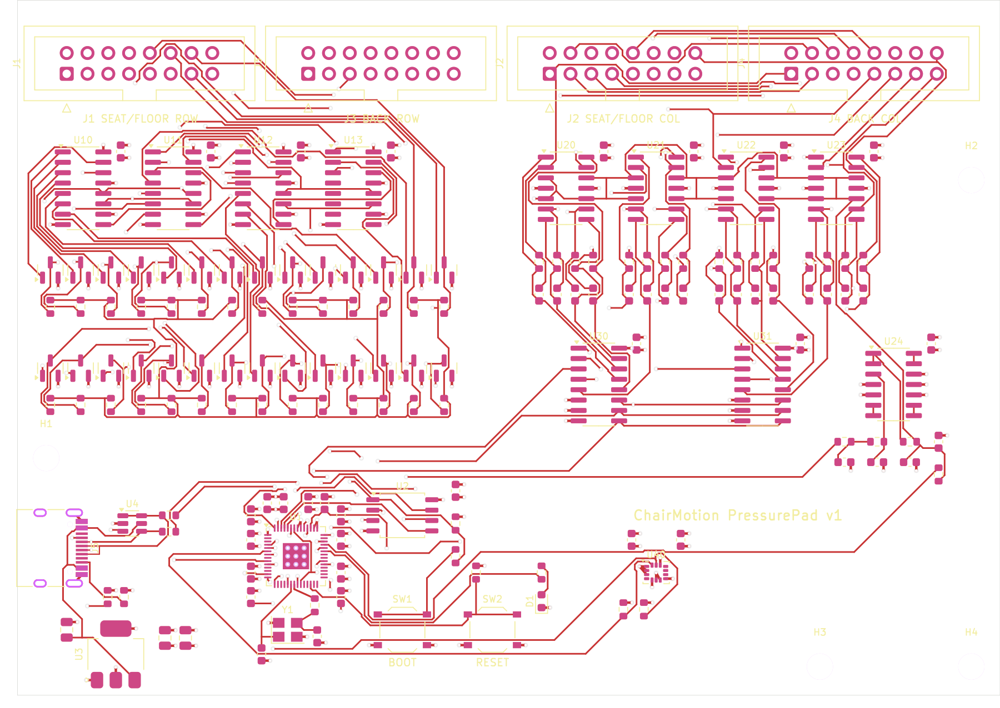

# PressurePad v1 基板（部品実装済みで注文する版）

椅子マット（座面＋背もたれ）と床マットの読み取り基板。**同じ基板を2枚注文し、プログラムの設定だけで椅子用・床用を切り替える。**
注文手順は [`docs/09_pcb_order_guide.md`](../../docs/09_pcb_order_guide.md)。

> ⚠️ 試作第1版：設計はコードから自動生成し、自動配線と DRC（設計ルールチェック）を通したもので、**実物での動作確認はまだ**。最初は少数（部品付き2枚）で注文すること。

**現在の状態（2026-10-24）**：DRC エラー 0、未配線 0（`jlcpcb/drc.txt`。部品の照合警告とシルク印刷の重なりなど見た目の指摘 173件は製造に影響しない）。配線幅 0.15〜0.3mm、ビア 0.6/0.3mm（USB 部のみ 0.5/0.25mm）、最小間隔 0.15mm で、JLCPCB の4層基板の標準仕様内。主要な接続（列16本・行28本・Vb・USB・水晶・フラッシュ）は接続一覧で意図どおりであることを確認済み。



## 仕様

| 項目 | 内容 |
|---|---|
| 大きさ・層数 | 120 × 85 mm、4層（内層1 = GND ベタ、内層2 = 3.3V ベタ） |
| マイコン | RP2040（＋ 16MB フラッシュ W25Q128、12MHz 水晶） |
| USB | USB-C（5.1kΩ で 5V 給電を要求、USBLC6 で静電気保護） |
| 電源 | USB 5V → AMS1117-3.3 |
| マット端子 | 2×8 ピンのボックスヘッダ ×4（J1 座面/床の行、J2 座面/床の列、J3 背もたれの行、J4 背もたれの列） |
| 行の駆動 | 74HC595 ×4（数珠つなぎ）→ AO3400A ×28（選択した行だけ GND へ）。全行は 2.2kΩ で Vb へプルアップ |
| 列の読み取り | MCP6004 ×4 による電流→電圧変換（TIA）×16（Rf 2.2kΩ ∥ 1nF、入力を Vb に固定）→ 74HC4051 ×2 → ADC0 / ADC2 |
| 基準電圧 Vb | PWM（GP22）→ 2段 RC → MCP6004 バッファ → 22Ω → Vb。ADC1 で実測。**プログラムで 1.65 / 1.0 / 0.6 / 0.35V を自動切替**（強く押されたセルが振り切れないように感度範囲を広げる） |
| 動きセンサー | LSM6DS3TR-C（I2C：GP4 SDA / GP5 SCL、割り込みピンは未接続で I2C で定期読み出し）。椅子の回転・傾きの測定用（ファームウェア対応は次の段階） |
| その他 | BOOT / RESET ボタン、動作 LED（GP25） |
| 読み取り | 448点（28行 × 16列）を 60Hz |

## 回路の考え方（ゼロ電位法）

```
          Vb ──2.2kΩ──┬─ 行 r ──[セル]── 列 c ──┬─(−) MCP6004 ─┬─ 出力 = Vb + I·Rf ─▶ 74HC4051 ─▶ ADC
                       │                          │  (+)= Vb     │
          74HC595 ─▶ AO3400A（選んだ行だけ ON → 行が 0V）    └── Rf 2.2kΩ ∥ 1nF ──┘
```

- 全列は TIA の働きで **Vb に固定**、選んでいない行もプルアップで **Vb** → 選んだ行以外のセルには電流が流れない（回り込みがない）。
- セルの導電率 G = (ADC の値 − Vb の値) / (Rf × Vb)。PC 側（`tools/pressure_pad/protocol.py`）は Vb を毎フレーム実測値で計算するので、Vb を切り替えても同じ値が出る。

## RP2040 のピン割り当て

| GPIO | 用途 | GPIO | 用途 |
|---|---|---|---|
| GP2 | 74HC595 SRCLK | GP22 | Vb の PWM |
| GP3 | 74HC595 SER | GP25 | 動作 LED |
| GP7 | 74HC595 RCLK | GP26 / ADC0 | 列 0〜7（74HC4051 #1） |
| GP10 / 11 / 12 | 74HC4051 S0 / S1 / S2（2個共通） | GP27 / ADC1 | Vb の実測 |
| GP4 / GP5 | I2C SDA / SCL（IMU） | GP28 / ADC2 | 列 8〜15（74HC4051 #2） |

## ファイル

| ファイル | 内容 |
|---|---|
| `gen_board.py` | **回路（接続）・部品・配置をすべて定義**し、KiCad の基板ファイルを生成。電源ピンのビア、USB-C と水晶まわりの手配線もここで行う |
| `route.py` / `ses_import.py` | Freerouting（自動配線）で配線し、結果を取り込む |
| `export.py` | DRC、ガーバー、ドリル、部品表（BOM）、配置表（CPL）、接続一覧、画像を出力 |
| `jlcpcb/` | **注文に使うファイル**（`gerbers.zip`、`bom.csv`、`cpl.csv`）、DRC の結果、接続一覧（`netlist.md`） |
| `images/` | 基板の画像（表・裏・部品配置） |
| `build/` | 生成途中のファイル（KiCad の `.kicad_pcb` は KiCad 7 以降で開ける） |

## 作り直し方（設計を変えたとき）

```
sudo apt install kicad xvfb openjdk-21-jre     # Ubuntu 24.04 の場合（KiCad 7）
pip install shapely cairosvg
/usr/bin/python3 gen_board.py
/usr/bin/python3 route.py freerouting-1.9.0.jar 30   # https://github.com/freerouting/freerouting/releases
/usr/bin/python3 export.py
```

## 部品（LCSC 番号は 2026年10月に jlcpcb.com / lcsc.com の掲載で確認）

| 部品 | LCSC | 区分 | 数 |
|---|---|---|---|
| RP2040 | C2040 | 拡張 | 1 |
| W25Q128JVSIQ | C97521 | | 1 |
| X322512MSB4SI（12MHz） | C9002 | | 1 |
| AMS1117-3.3 | C6186 | 基本 | 1 |
| TYPE-C-31-M-12（USB-C） | C165948 | 拡張 | 1 |
| USBLC6-2SC6 | C7519 | | 1 |
| 74HC595D | C5947 | | 4 |
| AO3400A | C20917 | 基本 | 28 |
| MCP6004T-I/SL | C7378 | 拡張 | 5 |
| 74HC4051D | C9386 | 拡張 | 2 |
| LSM6DS3TR-C | C967633 | 拡張 | 1 |
| TS-1187A（ボタン） | C318884 | 基本 | 2 |
| LED 赤 0603 | C2286 | 基本 | 1 |
| 2×8P ボックスヘッダ（挿入部品） | C3406 | | 4 |
| 抵抗 0603：1k / 2.2k / 5.1k / 10k / 22Ω | C21190 / C4190 / C23186 / C25804 / C23345 | 基本 | — |
| コンデンサ：100nF / 1µF / 1nF / 15pF（0603）、10µF（0805） | C14663 / C15849 / C1588 / C1644 / C15850 | 基本 | — |

「区分」の空欄は、検索結果で基本部品か拡張部品かを確認できなかったもの（注文画面に表示される）。

## 既知の注意点

- **部品の向き（CPL の回転）**：KiCad と JLCPCB では部品の基準の向きが違うものがあり、`export.py` で一般的な補正をしている。注文時のプレビューで1番ピンの位置を必ず確認する（09 §4）。
- **AMS1117 とセラミックコンデンサ**：古い AMS1117 は出力にタンタルコンデンサを想定しているが、10µF ×2 のセラミックで使う例が多い。発振などがあれば 22µF に変える。
- **USB-C**：5V のみ（PD 非対応）。CC の 5.1kΩ により、USB-C 充電器・PC の両方から給電される。
- **IMU** はハードウェアのみ実装済み。ファームウェアでの読み出しは次の段階。
